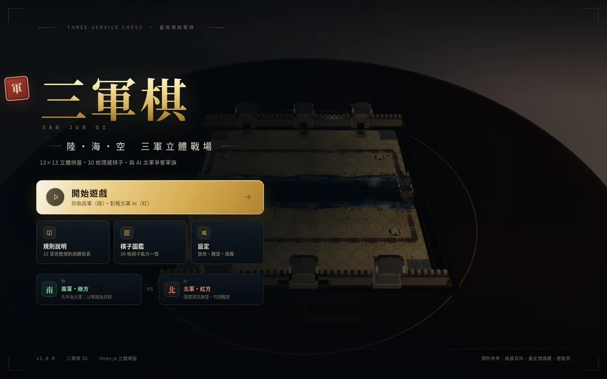
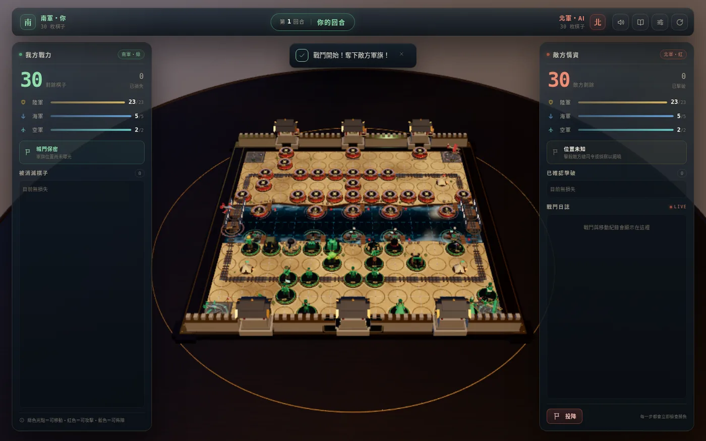
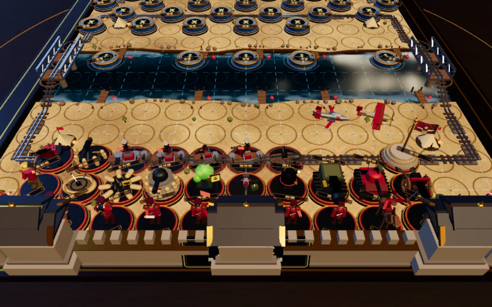
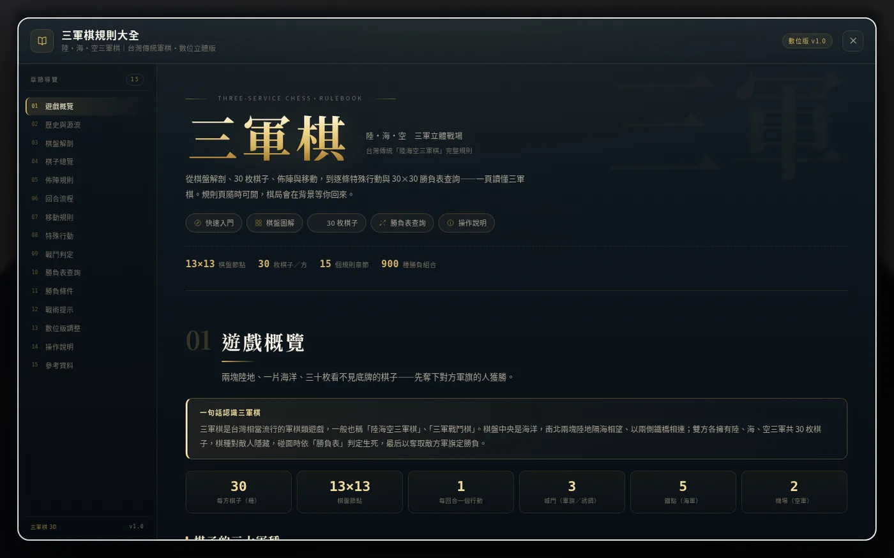
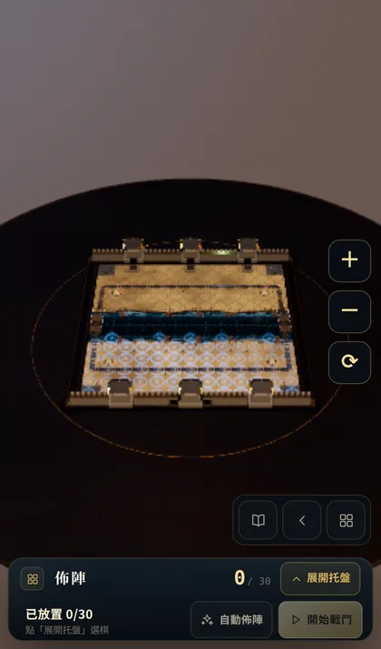
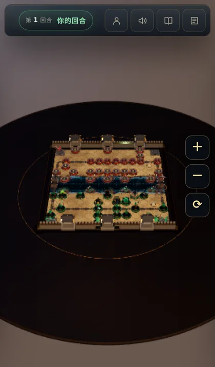
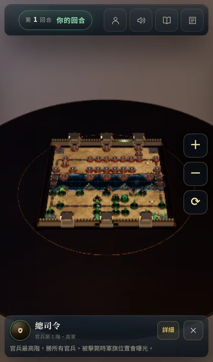
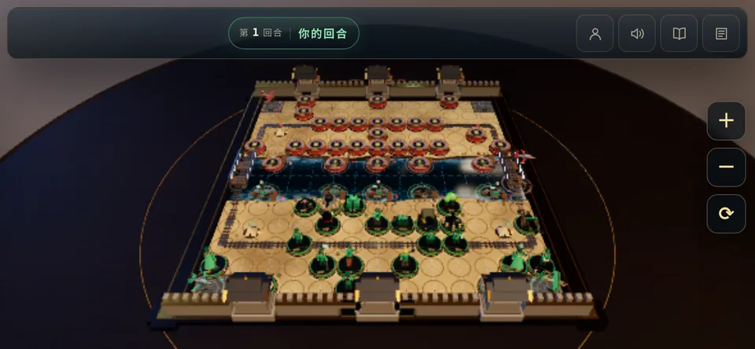

# 三軍棋 3D — 陸・海・空 三軍立體戰場

以 **three.js** 打造的台灣傳統 **三軍棋（陸海空三軍棋／三軍戰鬥棋）** 3D 網頁遊戲。
完整 30 枚棋子、隱藏資訊、裁判式勝負判定、**AI 對手**、立體棋子模型與動畫，以及一份詳細的中文規則書。

> 傳統三軍棋是台灣流行的軍棋類遊戲：棋盤中間為海洋，兩條鐵路在兩旁連接兩方；
> 陸軍、海軍、空軍三大軍種同場作戰，以奪取對方軍旗為勝利目標。
> 本作以國立臺灣歷史博物館典藏的「雷鳥體育文具廠有限公司出品之三軍戰鬥棋棋盤紙」
> 與維基百科、痞客邦規則整理為參考，重新繪製為對稱的 13×13 數位棋盤。

---

## 線上直接玩

**<https://threeservicechess.fungkingfai.workers.dev>**

（Cloudflare Workers 靜態部署，push 到 GitHub `main` 分支即自動更新。
本機、區網亦可依下方步驟自行啟動。手機可用瀏覽器「加到主畫面」，
以全螢幕 App 形式遊玩（已附 PWA manifest 與 icons）。）

## 遊戲畫面

| 主選單 | 對戰（HUD＋立體棋盤） |
|---|---|
|  |  |

| 30 枚棋子特寫 | 詳細規則頁 |
|---|---|
|  |  |

---

## 快速開始

需求：任何支援 WebGL2 的現代瀏覽器（Chrome / Edge / Firefox / Safari）；區網內可直接開。

```bash
cd sanjunqi
python3 -m http.server 8123
# 或 npm start
```

開啟 <http://127.0.0.1:8123/> 即可遊玩。**不需要** npm install、不需要建置流程；
three.js 已內附於 `vendor/three/`，完全離線可玩。

---

## 手機版

手機／平板（觸控裝置）已完整支援，直向、橫向都可玩：

- **佈陣托盤可收合**：預設收合成底部細條，讓棋盤完整露出；點「展開托盤」選棋，
  選好棋子後托盤自動收合，直接點棋盤藍點放置。
- **動態安全區取景**：3D 鏡頭會依 top bar／佈陣托盤／底部資訊卡的實際高度自動取景，
  棋盤（含南北城牆）完整落在可見區內；旋轉裝置或改變視窗大小會重新計算。
- **觸控優化**：觸控點擊容錯放大（棋子與棋盤格都有吸附容錯）、拖曳旋轉不會誤觸，
  支援雙指縮放，右側另有 **＋／－／⟳** 浮動鏡頭按鈕。
- **手機畫質**：自動使用 `medium` 畫質（關閉陰影、降低 bloom 與像素比）以維持流暢。
- **PWA**：可「加到主畫面」以獨立全螢幕 App 開啟（`manifest.webmanifest` + icons）。
- 多種小螢幕 UI：對戰 HUD 濃縮、抽屜式戰況／日誌、選中棋子資訊卡緊湊版、
  規則／圖鑑／結算／設定在 390×844 可完整滾動操作。

| 手機佈陣（收合） | 手機對戰 |
|---|---|
|  |  |

| 手機選棋（緊湊資訊卡） | 手機橫向 |
|---|---|
|  |  |

---

## 玩法

1. **開局佈陣**：玩家為南軍（綠），AI 為北軍（紅）。
   - 30 枚棋子：陸軍 23 枚（含軍旗）、海軍 5 艘、空軍 2 架。
   - 官兵與可動武器佈於我方陸地任一兵站；地雷／陷阱任佈陸地；
     炮壘只能佈在海岸砲位；軍旗必須藏在三座城門之一；海軍佈於五個錨點；空軍佈於兩座機場。
   - 可按「自動佈陣」一鍵完成，再手動微調。
2. **對戰**：每回合選擇一枚棋子行動一次。
   - 棋子點選後會顯示可走／可攻擊的位置（綠＝移動、紅＝攻擊、藍＝佈陣）。
   - 陸軍走一步；沿鐵路可走 1～3 站；海軍航行一步，可砲擊海岸或兩棲登陸；
     空軍沿空中航線直線飛行，可無限遠但轉彎要停。
   - 特殊行動：炮壘砲擊、炮艦砲擊、防空、飛彈直線轟擊、偵察機偵察。
3. **戰鬥**：棋子相遇時依勝負表判定（勝、敗、同歸於盡、不分勝負）。
   敵方棋子棋種隱藏（棋背），戰鬥、偵察與空軍可揭露情報。
4. **勝利**：奪得對方軍旗，或使對方無子可動。

完整規則請見遊戲內「規則說明」頁（亦收錄於 `content/`）。

### 操作

| 操作 | 說明 |
|---|---|
| 左鍵點棋子 | 選取我方棋子，顯示合法行動 |
| 左鍵點光點 | 移動／攻擊到該格 |
| 左鍵點另一枚己方棋 | 切換選取 |
| `Esc` | 取消選取 |
| 滑鼠拖曳（空白處） | 旋轉視角 |
| 滾輪 | 縮放 |
| 右鍵拖曳 | 平移視角 |

---

## 主要特色

- **13×13 立體棋盤**：黃土陸地、動態海洋、環形跨海鐵路、空中航線、錨點、機場、城牆與三座城門、行營。
- **30 種獨特 3D 棋子**：軍官小雕像、騎兵、步兵、工兵、坦克、大炮、高射炮、炮壘、地雷、陷阱、毒氣、
  飛彈、炸彈、原子炮、機槍、五種軍艦、戰鬥機、偵察機、軍旗——全部以程序化幾何＋PBR 材質製作，
  無外部模型檔。
- **隱藏資訊**：對手棋子只露出軍種棋背；戰鬥／偵察情報會逐步揭露。
- **AI 對手**：三個難度，會自動佈陣、依隱藏資訊推理、評估戰鬥期望與威脅，不作弊。
- **動畫與特效**：移動補間、戰鬥光爆、粒子、飛彈軌跡、偵察掃描、鏡頭震動、Bloom。
- **完整規則書**：30 枚棋子資料表、勝負表、特殊規則、數位版調整說明與參考資料。
- **手機可玩**：可收合佈陣托盤、動態安全區取景、觸控容錯、縮放按鈕、手機畫質與 PWA。
- **零依賴、免建置**：three.js 內附，開瀏覽器即玩。

---

## 專案結構

```
index.html                 入口（import map 掛載 three）
styles.css                 UI 樣式
src/main.js                遊戲控制器（流程／輸入／回合／整合）
src/core/board.js          棋盤資料與相鄰關係
src/core/pieces.js         30 枚棋子定義
src/core/combat-table.json 勝負表（由維基百科條目解析）
src/core/combat.js         勝負判定
src/core/legal-moves.js    合法行動產生
src/core/engine.js         遊戲狀態機
src/core/rng.js            可重現隨機
src/ai/                    AI（belief 推理 / 佈陣 / 評估 / 決策）
src/render/                three.js 場景、棋盤、30 枚棋子模型、動畫與特效
src/ui/                    DOM UI（選單／HUD／結算／圖鑑／設定）與規則頁
content/                   規則頁文案
vendor/three/              three.js r170 與 addons（離線內附）
tests/                     Node 測試（規則／AI）、桌面 e2e、手機 e2e（mobile-e2e.mjs）
assets/                    PWA icons（192/512/apple-touch）
manifest.webmanifest       手機「加到主畫面」設定
docs/                      README 遊戲截圖
wrangler.jsonc             Cloudflare Workers 靜態資產部署設定
```

### 測試

```bash
node tests/core.test.mjs     # 規則引擎單元測試
node tests/ai.test.mjs       # AI 測試
node tests/e2e.mjs           # Playwright 桌面端對端（需先啟動 http server）
node tests/mobile-e2e.mjs    # Playwright 手機端對端（iPhone 13 直向＋橫向、觸控）
```

---

### 部署（Cloudflare Workers）

本專案為純靜態網站，repo 內附 `wrangler.jsonc`（assets 目錄 = 專案根目錄）與 `.assetsignore`。
Cloudflare 已連結 GitHub repo，push 到 `main` 即自動部署至
<https://threeservicechess.fungkingfai.workers.dev>。

> 本機測試用低畫質模式（軟體渲染／無頭瀏覽器）：`index.html?lowfx=1`（關閉 bloom、降解析度、跳過動畫等待）。

## 規則摘要

- **官兵階級**：總司令 ＞ 兵團司令 ＞ 軍長 ＞ 師長 ＞ 團長 ＞ 營長 ＞ 連長 ＞ 排長 ＞ 騎兵 ＞ 步兵 ＞ 工兵。
  上級勝下級；官兵遇武器即敗，唯工兵可破地雷、毒氣、炸彈、炮壘、陷阱。
- **武器**：地雷／陷阱／炮壘不可移動；毒氣、飛彈、炸彈、原子炮、坦克車、大炮、高射炮、機關鎗可移動。
  飛彈可沿空中航線直線越過障礙轟擊（不可攻擊城門、機場）；高射炮可擊落兩格內敵機與飛越上空的敵機。
- **海軍**：主力艦 ＞ 巡洋艦 ＞ 炮艦 ＞ 驅逐艦；潛水艇剋主力艦／巡洋艦／炮艦，唯懼驅逐艦。
  主力艦、巡洋艦可兩棲登陸（登陸後戰力分別等同師長／團長）；炮艦可砲擊沿海陸軍與敵機。
- **空軍**：戰鬥機勝所有棋子，唯敗於高射炮與炮艦，飛越敵方高射炮／炮艦上空會被擊落；
  偵察機無戰鬥力，可偵察直線上敵棋使其曝光。
- **行營**：敵方陸軍不得攻擊營內棋子（海空攻擊不受限）。
- **軍旗**：藏於三座城門之一；被任何敵棋攻擊即敗。總司令陣亡時軍旗位置曝光。

完整勝負表與所有特例詳見遊戲內規則頁與 `src/core/combat-table.json`。

---

## 數位版調整（House Rules）

為使數位版流暢、可讀、公平，對原版規則做了以下調整，並在遊戲內規則頁完整說明：

1. 棋盤以傳統棋盤的概念重繪為 **13×13 對稱棋盤**：兩塊陸地夾海洋、環形跨海鐵路、
   每方 5 錨點、2 機場、3 城門、2 行營；棋盤尺寸與路線為數位化重製。
2. 移動採 **8 方向方格移動**（原版路線圖較複雜）；鐵路仍為每回合 1～3 站，
   跨海鐵橋因距離需在橋上停留（自然形成橋頭停留）。
3. 行營只阻擋陸軍攻擊；海軍砲擊、空軍、飛彈可攻擊營內棋子。
4. **空軍棋子永遠公開**（飛行器可見）；戰鬥參與的棋子會公開棋種。
5. 偵察機獲得的敵棋情報永久保留，並顯示於棋子與情報提示。
6. **城門誘餌**：三座城門皆可佈置任何陸軍棋子（一門一格）；軍旗藏在其中一座，
   敵方無法單憑「哪座門有棋」判斷軍旗位置（建議三門都放棋）。
7. **空軍禁攻城門**：戰鬥機／偵察機不可攻擊或停留在城門節點（可飛越）；
   軍旗只能被陸軍（或登陸部隊）攻破，避免空軍速攻斬首。偵察機仍可偵察城門上的棋子。

---

## 參考資料

- 維基百科：〈三軍棋〉（棋子與勝負表）<https://zh.wikipedia.org/wiki/%E4%B8%89%E8%BB%8D%E6%A3%8B>
- 國立臺灣歷史博物館典藏：〈雷鳥體育文具廠有限公司出品之三軍戰鬥棋棋盤紙〉
  <https://collections.nmth.gov.tw/CollectionContent.aspx?a=132&rno=2010.031.0527.0002>
- 痞客邦「紙上遊戲言舊苑」：〈話說棋盤遊戲之「攻位」系列(二)〉
  <https://j9981168.pixnet.net/blog/posts/9363276992>
- 國家文化記憶庫：雷鳥體育文具廠有限公司出品之三軍戰鬥棋遊戲
  <https://tcmb.culture.tw/zh-tw/detail?indexCode=MCOLLECTIONS&id=11000079880>

## 授權與致謝

- 程式碼：本專案原創，供學習與娛樂使用。
- three.js：MIT License（`vendor/three/` 內附版權聲明）。
- 棋制來源：台灣傳統三軍棋（民間遊戲，無單一著作權人）；規則整理引用上述公開資料。
